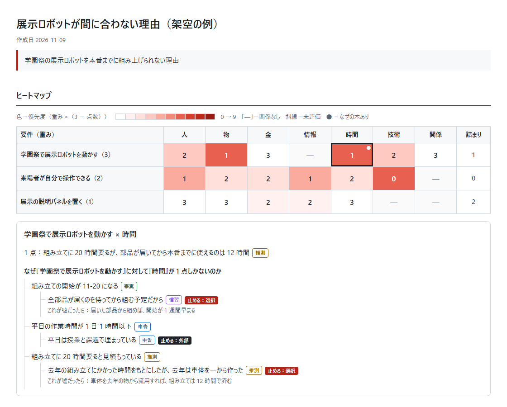

# first-principles

計画・事業・研究・学習などが「なぜうまくいかないのか」を、第一原理まで遡って考えるための Claude 用スキルです。

今ある資産と達成したい要件を表にし、足りない所をヒートマップで色分けして見せます。そのうえで、一番足りない所について「なぜ」を重ね、「普通はこうする」「前からこうしている」という前提を疑いながら、それ以上分解できない事実まで遡ります。最後に、その事実だけを材料にやり方を組み直し、一番自信のない前提を安く確かめる方法を 1 つ出します。



*架空の例「学園祭の展示ロボットが間に合わない理由」。マスの数字は足りている度合い（0〜3 点）、色は優先度です。マスを押すと、その点数の根拠と「なぜ」の木が出ます。見本の HTML は [examples/heatmap-sample.html](examples/heatmap-sample.html) にあり、ダウンロードしてブラウザで開くと操作できます。*

## 何をするスキルか

次の 7 段で進めます。要件と資産を表にした所と、掘るマスを選ぶ所で、Claude が内容をユーザーに確かめてから先に進みます。

| 段 | すること | できるもの |
|---|---|---|
| 1. 要件の把握 | 何を達成したいかを聞き、「それが叶うと何が良くなるか」を 2〜3 回重ねて本当の目的を探す | 要件表（重み・達成基準つき） |
| 2. 資産の把握 | 今あるものを人・物・金・情報・時間・技術・関係の区分で並べる。ファイルで確かめられるものは読んで確かめる | 資産表（出どころつき） |
| 3. 不足の把握 | 要件 × 区分の各マスに、足りている度合いを 0〜3 点で付け、根拠を 1 行書く | 点数表 |
| 4. 可視化 | 優先度＝重み ×（3 − 点数）で色を付け、掘るマスを 1〜3 個選ぶ | ヒートマップ |
| 5. 第一原理まで遡る | 選んだマスについて「なぜ」を重ね、原因を枝分かれさせながら止める条件まで遡る | 「なぜ」の木、前提の台帳 |
| 6. 再構築 | 事実と動かせない制約だけを材料に、外せる前提を外したやり方を 2〜3 個作る | 再構築案の比較表 |
| 7. 一番小さい検証 | 選んだ案が頼っている前提のうち、一番自信のないものを確かめる方法を決める | 検証の計画（成功と失敗の基準つき） |

### 5 回の「なぜ」との違い

5 回の「なぜ」をそのまま使うと、原因が 1 本に絞られる、5 回で機械的に止まる、「担当者の注意不足」のような人のせいで止まる、という弱点があります。このスキルでは次の 4 つを守ります。

1. **札を付ける。** 要件・資産・なぜの答えのそれぞれに、事実（ファイルや数値で確かめた）／申告（本人が言った）／推測（Claude が補った）／慣習（「普通はこう」「前からこう」）のどれかを付けます。疑う対象は、推測と慣習の札が付いたものです。
2. **「5 回」では止めない。** 物理・お金の制約、自分では変えられない外の決まり、変えられる「選択」や「慣習」のどれかに着いたら止めます。人のせいに着いたら、なぜその人がそう動くのかを仕組みの側へもう一段掘ります。
3. **要件も疑う。** 「サイトを作りたい」のような手段が要件に化けていないかを、先に確かめます。
4. **抽象的な表現を使わない。** 「リソース不足」「連携の強化」「意識が低い」のような言葉は、誰が・何を・どれだけ・いつまでに、の形に言い換えます。ユーザーの言葉が抽象的なら、具体的な場面を聞き返します。

## 入れ方

### Claude Code

Claude Code で次の 2 つを順に実行します。

```
/plugin marketplace add kaisco37/first-principles
```

```
/plugin install first-principles@first-principles
```

更新は `/plugin marketplace update first-principles` で取り込めます。

プラグインを使わずに入れる場合は、リポジトリを取ってきて、スキルのフォルダを `~/.claude/skills/` に写します。

```bash
git clone https://github.com/kaisco37/first-principles.git
```

macOS・Linux：

```bash
cp -r first-principles/skills/first-principles ~/.claude/skills/
```

Windows（PowerShell）：

```powershell
Copy-Item -Recurse first-principles\skills\first-principles $HOME\.claude\skills\
```

### claude.ai

[Releases](https://github.com/kaisco37/first-principles/releases) から `first-principles.zip` をダウンロードし、claude.ai の「設定 → 機能」の「スキル」にアップロードします。ヒートマップの HTML を作るには、同じ画面でコード実行とファイル作成を有効にしてください。

## 使い方

入れたあとに、次のように頼むと使えます。「第一原理」という言葉が入っていると呼び出されやすくなります。

- 「新規事業がうまくいかない。第一原理思考で考え直したい」
- 「研究が進まない理由を、第一原理まで遡って整理して」
- 「英語の勉強が続かない。普通はこうだからという前提を疑いながら考えたい」
- 「今あるものと足りないものをヒートマップにして、なぜうまくいかないのかを前提から疑ってほしい」

最初に、結果を会話だけで返すか、ファイルに残すかを聞かれます。

- **会話だけ**：ヒートマップは点数と記号（■）の表で、「なぜ」の木は文字の木で示されます。
- **ファイル**：保存先を提案され、承認すると次の 2 つが作られます。
  - `heatmap.html`：ヒートマップ・「なぜ」の木・前提の台帳・再構築案・検証の計画を 1 枚にまとめたページ。マスを押すと根拠と木が出ます。
  - `report.md`：7 段の結果をまとめた文書。

### 向いていないこと

- コードの不具合の原因調査（再現・切り分け・修正の手順で進めるほうが早い）
- 本番障害の対応（原因を遡る前に、復旧を先にする）
- 第一原理思考とは何かを知りたいだけのとき（このスキルは使わずに、そのまま説明します）

## 構成

| パス | 内容 |
|---|---|
| `skills/first-principles/SKILL.md` | スキルの本体。7 段の流れと守ること |
| `skills/first-principles/references/` | 各段の聞き方と表の書式、抽象語の言い換え表、「なぜ」の木の作り方、点数の基準 |
| `skills/first-principles/assets/` | ヒートマップの HTML のひな形と、`report.md` の型 |
| `examples/heatmap-sample.html` | 架空の例を入れたヒートマップの見本 |
| `.claude-plugin/` | Claude Code のプラグインとマーケットプレイスの設定 |

## ライセンス

MIT License（`LICENSE`）
